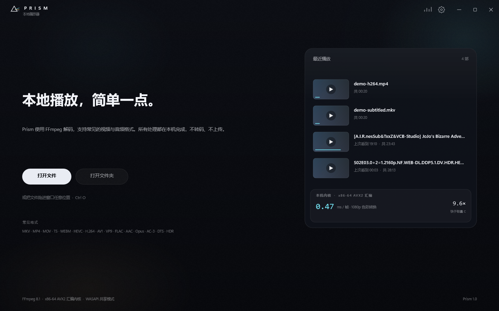
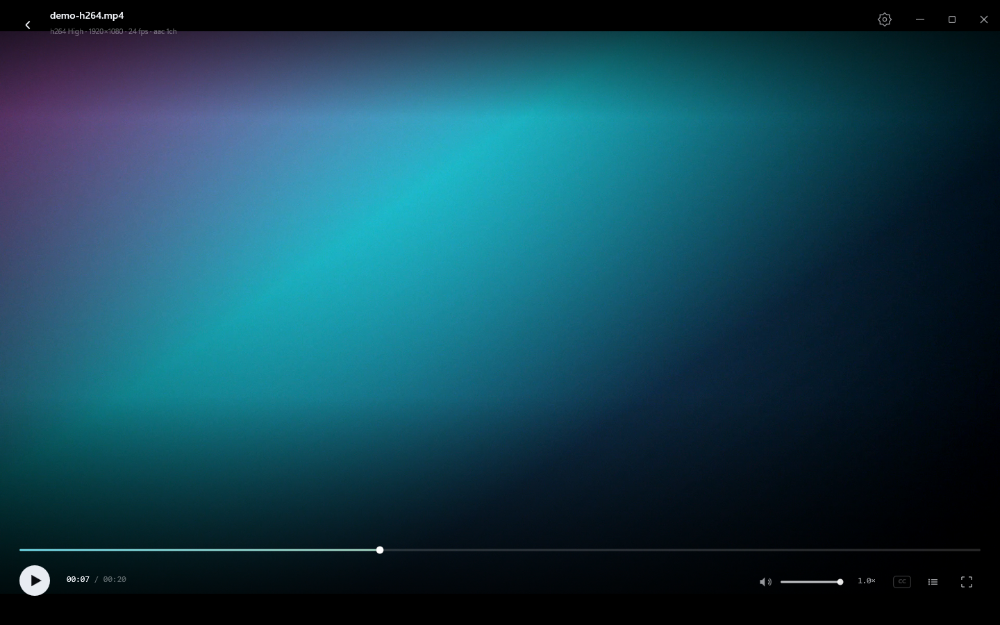
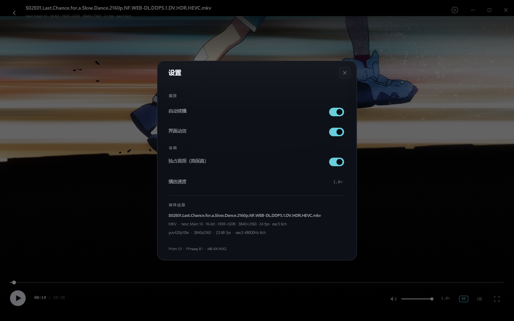
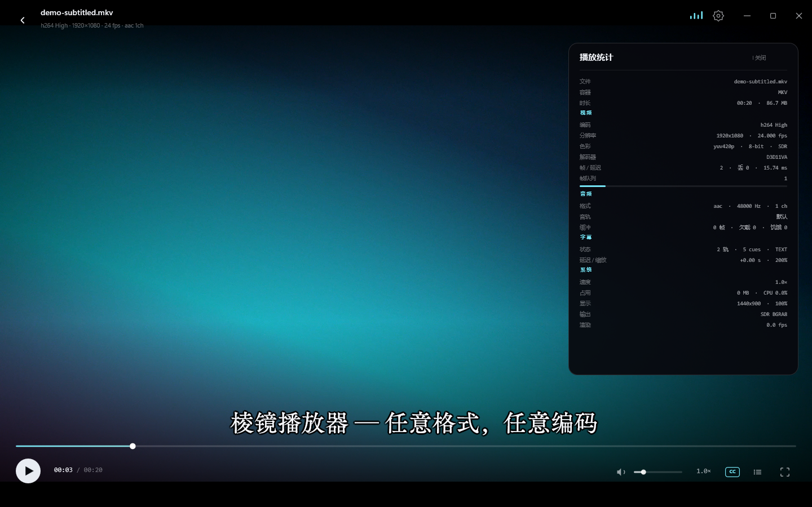
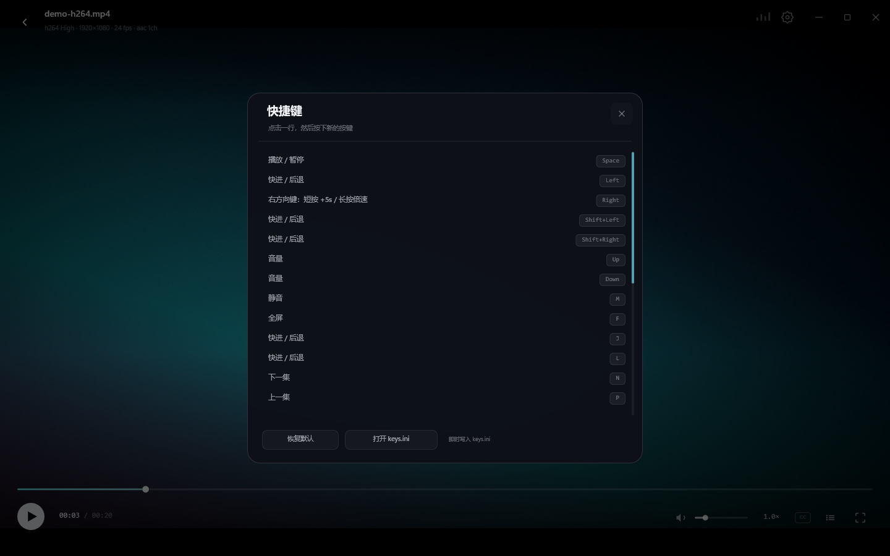
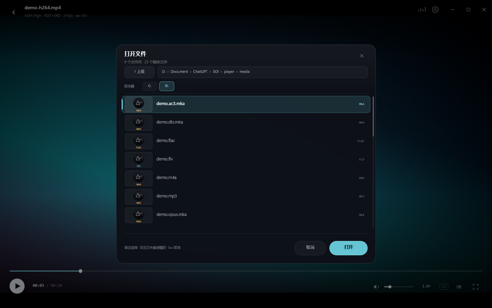
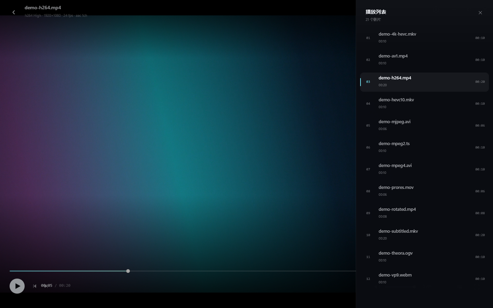
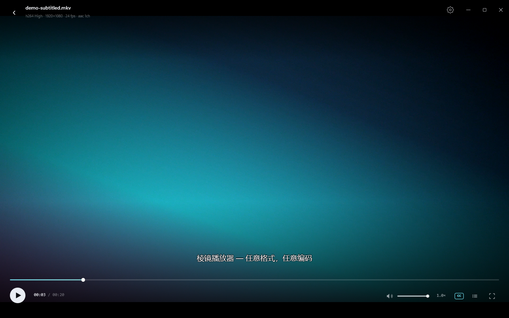
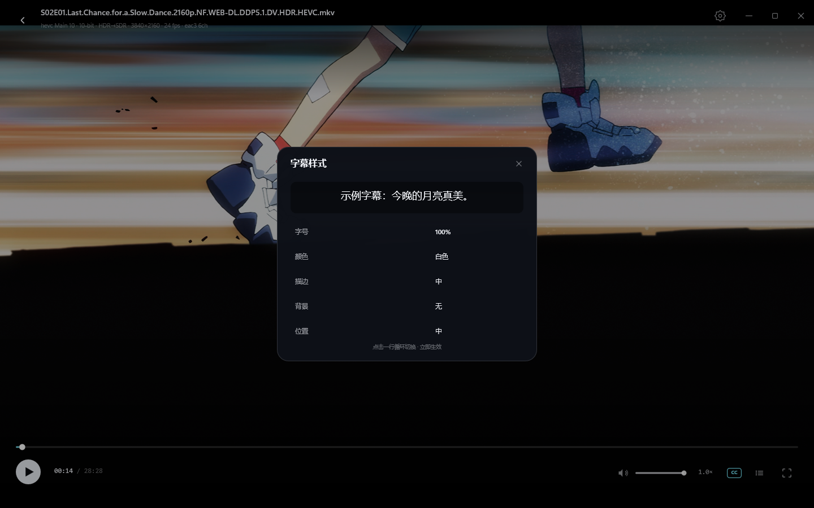
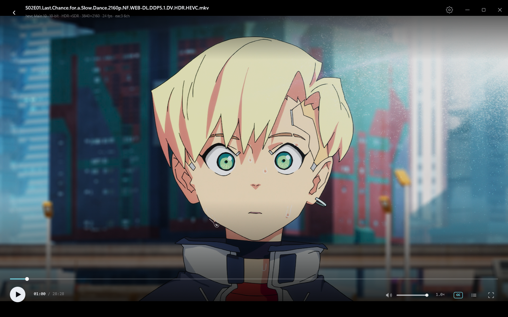

# Prism · 棱镜播放器

> 任意容器，任意编码，视频音频通吃。原生 Windows，零转码，汇编级性能。

[](LICENSE)
[]()
[]()
[](https://github.com/huy878007-pixel/prism-player/releases/latest)



Prism 是一个用 **C++20 / Win32 / Direct2D / Direct3D 11** 从零写的本地播放器。解码交给 FFmpeg 8.1，
颜色转换和 HDR 输出走自写的 GPU 着色器与 x86-64 AVX2 内核；界面没有使用任何 UI 框架。
双击即用，拖入即播，不联网、不上传、不转码。

本仓库是**源码仓库**：不包含 FFmpeg 二进制、`_vendor/` 或 `dist/`（FFmpeg 的 `avcodec` 单个 DLL 就超过
GitHub 普通文件限制）。预编译的 Windows x64 版本在 [Releases](https://github.com/huy878007-pixel/prism-player/releases/latest)；
从源码构建见下方 [从源码构建](#从源码构建)。

---

## 界面

| | |
|---|---|
|  |  |
|  |  |
|  |  |
|  |  |
|  |  |

## 亮点

- **原生 HDR**：HDR10/PQ 片源在 HDR 显示器上走 **scRGB 16F** 输出（`R16G16B16A16_FLOAT` +
  `RGB_FULL_G10_NONE_P709`），UI 以 203 nits SDR 白映射；SDR 显示器才回退 Hable tonemap。
- **硬件解码**：D3D11VA 优先，失败自动回退 FFmpeg 软解；硬解/软解画面逐像素一致。
- **任意格式**：MKV、MP4、MOV、AVI、TS、M2TS、FLV、WMV、WebM、OGV、RMVB、ProRes、MJPEG、
  MPEG-2、MPEG-4、H.264、HEVC 8/10-bit、AV1、VP9、Theora；FLAC、WAV、MP3、AAC、Opus、AC-3、
  DTS 等音频。
- **外挂音轨**：视频无音轨时自动配对同名 `.mka/.flac/.wav/.aac/.opus/.m4a`，支持多音轨切换。
- **字幕**：内嵌文本字幕后台提取；`.srt/.ass/.ssa/.vtt` 自动侧载；ASS 走 libass 原生特效；
  系统字体选择、拖动、`Ctrl+滚轮` 0.5×–5.0×、延迟、双字幕（第二条文本轨）。
- **边下边看**：直接打开 `.qkdownloading/.part` 等下载中的文件，追到下载末尾会等待并提示，
  下载器改名完成后正常结束/自动下一集。
- **播放列表**：打开文件自动扫描当前文件夹，自然排序、当前集高亮、`N/P` 切集、自动下一集、
  每 0.8 秒增量刷新。
- **文件浏览器**：Prism 自绘，不再依赖会卡住的原生 Explorer 对话框；支持视频缩略图。
- **设置与统计**：双栏设置、媒体/系统数据、`I` 播放统计浮层、图形化快捷键编辑器。
- **文件图标**：29 种格式的圆形 Prism + 格式标签图标，可注册到当前用户。

## 下载

预编译 Windows x64 版本在 **[Releases](https://github.com/huy878007-pixel/prism-player/releases/latest)**。
下载 `Prism-1.0.2-win64.zip`，解压后运行 `Prism\Prism.exe`，无需安装。

Release 包内包含 FFmpeg 8.1 shared（GPLv3）和 libass 0.17.5（ISC）的运行时 DLL 与许可文件；
Prism 自身以 AGPL-3.0-only 发布，源码与二进制对应的 tag 在同一 Release 页面提供。

## 从源码构建

### 依赖

- Windows 10/11 x64
- Visual Studio 2022（Desktop development with C++）
- CMake 3.25+、Ninja
- NASM（`src/asm/kernels.asm`）
- [BtbN FFmpeg-Builds](https://github.com/BtbN/FFmpeg-Builds/releases)
  `ffmpeg-master-latest-win64-gpl-shared.zip`，解压到：

  ```text
  _vendor/ffmpeg/ffmpeg-master-latest-win64-gpl-shared/
  ```

- libass 0.17.5 x64：把头文件放到 `_vendor/libass/include/ass/`，
  `libass-9.dll` 放 `_vendor/libass/`（运行时动态加载）

### 构建

```powershell
.\build.ps1 -Dist
.\dist\Prism\Prism.exe
```

`build.ps1` 会调用 CMake/Ninja、复制 FFmpeg/libass DLL，并把 `README.md`、`THIRD_PARTY_NOTICES.md`、
`LICENSE`、`resources/file-icons` 和 `RegisterFileTypes.ps1` 放进 `dist\Prism`。

> 修改头文件后必须 clean build（`.\build.ps1 -Clean`）；MSVC 的 `/showIncludes` 在中文环境下可能让
> Ninja 的依赖跟踪失效。

## 使用

- 拖入窗口、`Ctrl+O`，或点「打开文件 / 打开文件夹」。
- 打开单个文件会自动把同目录媒体加入播放列表。
- 上次看到的位置会自动记住（超过 20 秒才续播）。
- 字幕：点 CC 打开字幕面板；`V` 切轨，`Alt+V` 开关副字幕，`Ctrl+滚轮` 缩放。
- 音轨：`A` / `Shift+A` 循环切换。
- 统计：`I` 或右上角柱状图标。
- 快捷键：`F1` 或「设置 → 快捷键…」打开图形化编辑器；`F2` 从 `keys.ini` 重载。

## 快捷键

| 按键 | 功能 |
|---|---|
| `Space` / `K` | 播放 / 暂停 |
| `←` / `→` | 后退 / 前进 5 秒 |
| `Shift + ←` / `Shift + →` | 后退 / 前进 1 秒 |
| `J` / `L` | 后退 / 前进 10 秒 |
| `↑` / `↓` | 音量 ±5% |
| `M` | 静音 |
| `F` | 全屏 / 退出全屏 |
| `Esc` | 退出全屏 / 关闭面板 / 返回首页 |
| `N` / `P` / `B` | 下一集 / 上一集 |
| `V` / `Shift+V` | 下一条 / 上一条字幕 |
| `Alt+V` | 副字幕开关 |
| `A` / `Shift+A` | 下一条 / 上一条音轨 |
| `I` | 播放统计 |
| `F1` / `F2` | 图形化快捷键编辑器 / 重新加载 |
| `Ctrl+O` | 打开文件 |

**右方向键手势**：短按 `+5 秒`；按住超过 `0.32 秒` 进入 `3×` 播放，松开恢复原速。
旧版 `keys.ini` 中的 `right = boost` 会自动迁移为 `seek_boost`。

## 默认应用与文件图标

```powershell
.\dist\Prism\RegisterFileTypes.ps1 -Associate
```

- 只写 HKCU，不需要管理员。
- 把 Prism 注册进 Windows「默认应用」，并注册 29 种媒体格式的图标。
- Windows 10/11 的 `UserChoice` 是受保护的：如果扩展名已被其他播放器占用，脚本会列出冲突并打开
  「设置 → 默认应用」，在 Prism 里确认「设置默认文件类型」即可。
- 还原：`-Restore`；移除：`-Unregister`。

图标只在 Prism 是该扩展名的默认应用时由 Explorer 使用；如果仍由其他播放器打开，Explorer 会显示
那个播放器的图标。

## 架构

```text
src/
  entry.cpp      Win32 窗口、消息循环、headless --render、CLI
  engine.cpp     FFmpeg 解封装/解码、D3D11VA、A/V 时钟、seek、字幕任务
  audio.cpp      WASAPI 共享/独占、环形缓冲、重采样、时钟
  gfx.cpp        D3D11 + D2D + DXGI 交换链、scRGB HDR、YUV/P010 着色器
  paint.cpp      Direct2D 立即模式绘制、文本格式缓存、缩略图位图
  ui.cpp         状态机、布局、命中测试、播放列表/设置/文件浏览器
  draw.cpp       首页/播放器/面板/统计/Toast 绘制
  ass_render.cpp libass 动态加载与 BGRA 合成
  thumbs.cpp     Windows Shell 缩略图工作线程
  asm_c.cpp      AVX2 颜色内核；asm/kernels.asm NASM 路径
```

## 性能

本机（RTX 5060 + 4K HDR 显示器）实测：

- 4K HDR HEVC 10-bit：约 **2.55 ms/帧**，0 丢帧，内存约 1.3 GB。
- 同一 4K HDR 片源硬解：CPU 约 3.9%（113 帧 / 5 秒），内存约 1.14 GB；
  软解基线约 13.8% / 1.44 GB。
- 1080p HEVC 10-bit + 外挂 FLAC：硬解 0 underrun / 0 starvation。
- 8-bit 转换 AVX2 内核约为标量路径的 9–10×。

## 已知限制

- **PGS/DVD/DVB 位图字幕尚未渲染**；当前支持文本字幕与 libass ASS。
- 双字幕的第二条是**纯文本层**，不带 ASS 特效。
- 硬解目前是 D3D11VA 解码后回读 P010，**零拷贝 GPU 直通尚未完成**。
- 杜比视界只使用 HDR10 兼容基底，动态 RPU 未解析；HLG 未单独映射。
- Windows 音频设备拒绝独占时自动回退共享模式；5.1 在共享设备上下混立体声。
- 未完成的 MP4（`moov` 在文件尾）在索引到达前无法播放；MKV/TS 通常可以边下边看。
- 外挂字体/字幕/音轨仅支持本地文件；网络流未接入。

## 开发状态

这是个人项目，按真实片源持续打磨。当前重点是：

1. PGS 位图字幕
2. 零拷贝 D3D11VA
3. 帧节奏与更高阶缩放
4. 字幕/音轨菜单的完整可视化

## 交接文档

后续维护者/接手的 AI 请先读 [docs/AI_HANDOFF.md](docs/AI_HANDOFF.md)：包含当前状态、源码地图、线程模型、
已知问题、验证命令和不要破坏的契约。

## 许可

Prism 以 **GNU Affero General Public License v3.0 only** 发布，见 [LICENSE](LICENSE)。
如果你修改 Prism 并通过网络向用户提供服务，AGPL 要求你向这些用户提供对应的完整源码。

FFmpeg、libass 及其他第三方组件的许可与再分发要求见 [THIRD_PARTY_NOTICES.md](THIRD_PARTY_NOTICES.md)。

Copyright (C) 2026 huy878007-pixel.
