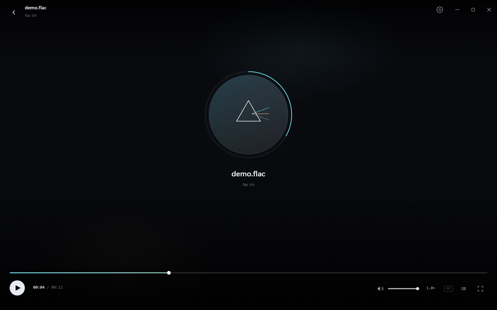
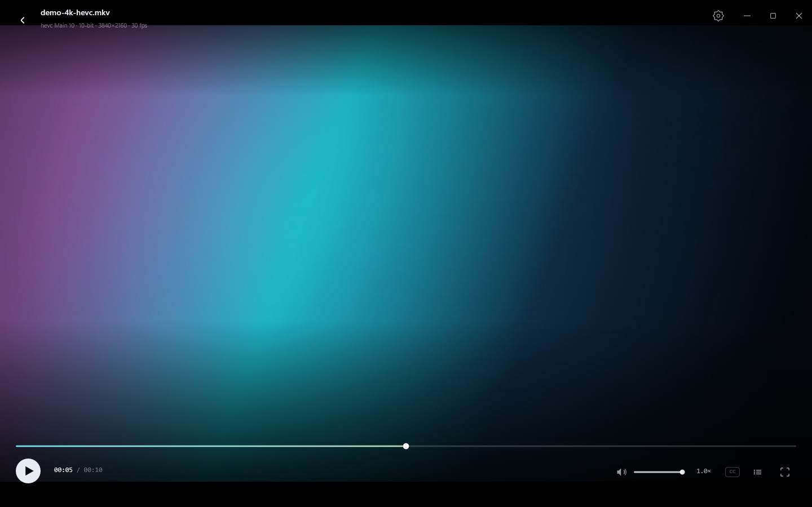
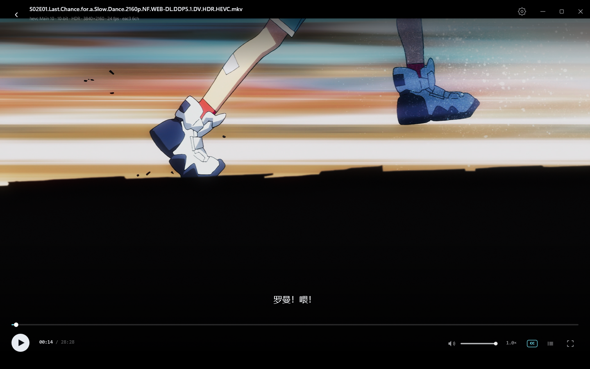
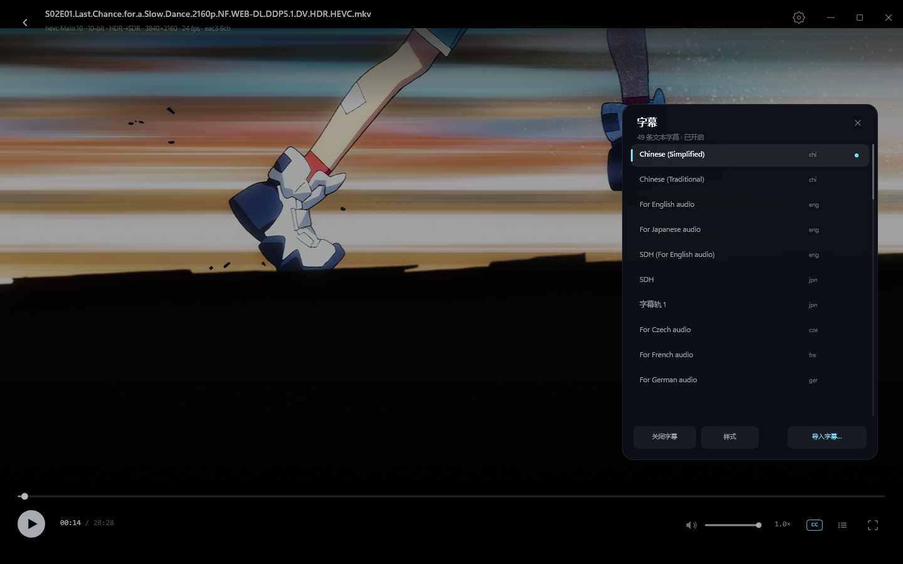

# Prism · 棱镜播放器

> 任意容器，任意编码，视频音频通吃。原生 Windows，零转码，汇编级性能。


Prism 是一个用 C++ / Win32 / Direct2D 从零写的本地播放器：解码交给 FFmpeg 8.1，
色彩转换走自写的 x86-64 AVX2 汇编内核，HDR 色调映射由 GPU 像素着色器完成，界面没有使用任何 UI 框架。


---

## 功能

- **任意格式 / 任意编码**：FFmpeg 原生解码，实测通过 MKV、MP4、MOV、AVI、TS、FLV、WMV、OGV、WebM、
  ProRes、MJPEG、MPEG-2、MPEG-4、H.264、HEVC 8/10-bit、AV1、VP9、Theora，以及 FLAC、WAV、MP3、AAC、
  Opus、AC-3、DTS 等音频格式。见 [格式验证报告](docs/format-verification.txt)。
- **硬件解码**：D3D11VA 硬解 + 自动软解回退；4K HDR 实测 CPU 2.39 s / 5.11 s（约 3.9%），
  内存 1143 MB（软解 1439 MB），0 丢帧；硬解与软解画面逐像素一致。
- **视频**：8 位与 10 位 YUV，BT.601 / BT.709 / BT.2020，limited / full range，显示矩阵旋转，
  4K 软解（性能取决于 CPU）。10-bit 先由 AVX2 打包为 8-bit 再走汇编色彩内核，4K HEVC 10-bit
  实测约 5 ms/帧。
- **边下边看**：可直接打开 `.qkdownloading`/`.part` 等下载中的文件；播放器按增长文件读取，
  追到下载末尾会自动暂停并提示“缓冲中：等待下载…”，下载器重命名完成后正常结束/自动下一集。
  文件浏览器和本文件夹扫描也会显示下载中的媒体。
- **大文件**：流式解封装，50 GB+ 的蓝光 remux 不需要预载，内存不随文件大小增长（4K 播放约 1.1 GB）。
- **本文件夹**：打开文件自动扫描同目录媒体，自然排序、集数识别、当前集高亮、播完自动下一集。
- **HDR / 杜比视界**：显示器 HDR 开启时，HDR10 片源走 **scRGB 原生输出**（16F 交换链、UI 以 203 nits
  为 SDR 白，不做 tonemap）；SDR 显示器自动回退 Hable 映射；杜比视界 Profile 8 走 HDR10 基底。
  4K HDR 实测约 3 ms/帧，24fps 稳定。
- **双字幕**：`Alt+V` 从其余字幕轨中载入第二条纯文本字幕，显示在主字幕上方；主字幕仍可保持 ASS 原生特效。，播放/打开不再等待扫描；自动优先简体中文；点击 CC 打开字幕面板，可切换内嵌的 49 条字幕轨、导入
  SRT/ASS/SSA/VTT、自动加载同名外挂字幕；字号、颜色、描边、背景、位置全部可调。字幕可直接拖动，
  `Ctrl+滚轮` 自由缩放（0.5×–5.0×），延迟可通过快捷键调整；字幕样式面板的应用内字体选择器
  列出系统已安装字体（DirectWrite，只对字幕生效，不加载字体文件）。
- **音频**：WASAPI 独占高保真模式（默认开启，失败自动回退共享），32-bit float / 24-bit PCM；
  设备支持 5.1 时原样输出，否则用高质量下混成立体声。
- **播放**：拖动/点击进度条、±5s / ±10s 快进、0.25×–4× 变速、全屏、单曲循环（重播）、
  文件夹播放列表、上一集/下一集、最近播放与断点续播。
- **放大**：1080p → 1440p 使用 Direct2D 高质量三次插值，比双线性更锐利。
- **界面**：Direct2D 自绘无边框窗口，深色影院风，自动隐藏控制栏，悬停预览时间，
  播放列表面板、设置面板、Toast、动画与 125% DPI 适配。
- **零依赖部署**：一个 exe + FFmpeg DLL，绿色免安装。

## 截图

| | |
|---|---|
|  |  |
|  |  |
|  |  |
|  |  |
|  |  |

## 快速开始

```powershell
.\build.ps1 -Dist          # 构建并打包到 dist\Prism
.\dist\Prism\Prism.exe     # 双击也可以
```

也可以直接双击 `dist\Prism\启动 Prism.cmd`。

打开影片：拖入窗口、`Ctrl+O`、或「打开文件夹」把整个目录加入播放列表。
上次看到的位置会自动记住（超过 20 秒才会续播）。

`dist\Prism\samples\` 里放了几个小样片：4K HEVC 10-bit、AV1、HEVC 10-bit、带内嵌字幕的 MKV，
以及 FLAC / MP3，可以直接拖进窗口或双击播放。


## Build from source

Prebuilt binaries and `_vendor/` are not committed because the FFmpeg shared build is over 100 MB.

1. Install Visual Studio 2022 C++ tools, CMake, Ninja and NASM.
2. Download a BtbN FFmpeg 8.1 **shared win64** build and place it at
   `_vendor/ffmpeg/ffmpeg-master-latest-win64-gpl-shared` (headers + `lib/` + `bin/*.dll`).
3. Download libass 0.17.5 x64 (headers + `libass-9.dll`) into `_vendor/libass`
   (`include/ass/`, `libass-9.dll`). The app loads it dynamically.
4. Build and package:

```powershell
.\build.ps1 -Dist
.\dist\Prism\Prism.exe
```

The file-type icons and registration helper are in `resources/`; run
`dist\Prism\RegisterFileTypes.ps1 -Associate` after packaging to register Prism
and install the per-format icons in HKCU.

## 快捷键

| 按键 | 功能 |
|---|---|
| `Space` / `K` | 播放 / 暂停 |
| `←` / `→` | 后退 / 快进 5 秒（`Shift` 为 1 秒） |
| `J` / `L` | 后退 / 快进 10 秒 |
| `↑` / `↓` 或滚轮 | 音量 ±5% |
| `M` | 静音 |
| `F` | 全屏 / 退出全屏 |
| `Esc` | 退出全屏 / 关闭面板 / 返回首页 |
| `N` / `P` | 下一集 / 上一集 |
| `B` | 上一集 |
| `Home` / `End` | 跳到开头 / 结尾 |
| `+` / `-` | 加速 / 减速 |
| `Ctrl+O` | 打开文件 |
| `Enter` | 首页打开文件 |
| `V` | 循环切换字幕轨（内嵌 + 外挂） |
| `Alt+V` | 开启/关闭副字幕（第二条文本轨，显示在主字幕上方） |
| `A` / `Shift+A` | 循环切换音轨（内嵌/外挂 MKA） |
| `I` | 显示/关闭播放统计 |
| `F1` / `F2` | 打开快捷键配置 / 重新加载 |

## 默认播放器与文件图标

- 运行 `dist\Prism\RegisterFileTypes.ps1 -Associate`（只写 HKCU，不需要管理员）
- 会把 Prism 注册进 Windows“默认应用”，并为 29 种视频/音频格式生成**圆形 Prism + 格式标签**图标
- 图标在 `%LOCALAPPDATA%\Prism\icons`，注册后由 Explorer 使用
- Windows 10/11 的 `UserChoice` 是受保护的：如果某个扩展名已经被 Quark/foobar/WMP 占用，脚本会列出冲突并打开默认应用设置，
  在 **设置 → 应用 → 默认应用 → Prism → 设置默认文件类型** 里确认一下即可
- 还原：`RegisterFileTypes.ps1 -Restore`；移除注册：`-Unregister`

图标只在 Prism 是该扩展名的默认应用时显示；如果仍由别的播放器打开，Windows 会继续显示那个播放器的图标。

## 设置与播放统计

- 设置面板现在是双栏：左侧播放/画面/音频字幕选项，右侧实时媒体信息（容器、时长、视频编码、色彩、解码器、音轨、字幕、缓冲、显示、内存）。
- 播放界面右上角新增统计按钮，也可以按 `I`：显示分辨率、帧率、色彩、解码器、帧/丢帧/解码耗时、队列、音频缓冲/欠载、字幕、CPU/内存、渲染 FPS。
- 文件浏览器支持视频缩略图（Windows Shell 缩略图，异步加载并缓存）。
- 当前媒体目录每 0.8 秒增量检查一次：下载中的 `.qkdownloading`、完成后的新文件会自动进入播放列表。

## 快捷键自定义

首次运行会生成 `%LOCALAPPDATA%\Prism\keys.ini`，所有按键和动作都可以改，改完按 `F2` 生效或 `F1` 打开文件。

默认配置里 `right = boost 3.0`：**按住右方向键 3× 播放，松开恢复原速**；`shift+right = seek 1`。
支持的动作：`toggle play pause seek seek_start seek_end volume mute fullscreen speed boost next prev
subtitle_toggle subtitle_next subtitle_prev subtitle_delay open keys reload_keys escape quit`。
例如：

```ini
right       = boost 3.0
left        = seek -5
shift+right = seek 10
v           = subtitle_next
[           = subtitle_delay -0.1
]           = subtitle_delay 0.1
```

## 本文件夹

打开单个文件时，Prism 会自动扫描同目录下的视频/音频（自然排序，跳过 `.part` / `.qkdownloading`），
加入播放列表；`N/P` 切集，当前集高亮，播完自动下一集。

## 性能

自写的 AVX2 内核负责把解码后的 YUV 转成 BGRA（BT.601/709/2020，limited/full）。
它和标量 C 参考实现**逐字节一致**，benchmark 同时校验正确性与吞吐：

```
CPU: AMD Ryzen 5 9600X 6-Core Processor | AVX2 + AVX-512
1920x1080, 300 frames:
  scalar C reference   4.21 ms/frame    237 fps
  hand-written AVX2    0.47 ms/frame   2150 fps   (8.9x)
3840x2160, 60 frames:
  scalar C reference  16.27 ms/frame     61 fps
  hand-written AVX2    1.85 ms/frame    540 fps   (8.8x)
```

4K HDR（3840×2160、23.976 fps、杜比视界 HDR10 基底）：解码 + 平面拷贝 **3.07 ms/帧**，
174 帧 / 7 秒，0 丢帧，内存 1.45 GB。4K HEVC 10-bit SDR（133 Mbps 压力样片）：解码 + 色彩转换 **5.0 ms/帧**，
连续播放 174 帧 / 6.84 秒，丢 4 帧，内存稳定在 **1.1 GB**；FFmpeg 自身解码该样片约 3.5× 实时。

完整输出见 [benchmark.txt](docs/benchmark.txt)，运行 `build\bin\prism_bench.exe` 可复现。
FFmpeg 自身的解码、IDCT、预测同样是手写 SIMD 汇编，Prism 在这层之上又加了自己的热路径。
作为参照，FFmpeg 自身在本机软解测试样片的速度：1080p HEVC 10-bit 约 44× 实时，
4K HEVC 10-bit 约 10.9× 实时（`ffmpeg -benchmark` 实测）。再加上每帧约 1.9 ms 的
AVX2 色彩转换，1080p 与 4K 都能轻松覆盖 24/30fps 的播放。

启动到出画面约 0.5 秒（含一次 30 帧的内核自测），空闲时 CPU 占用接近 0（只在有新帧或动画时重绘）。

## 架构

```
src/
  entry.cpp          Win32 窗口、无边框/DPI、消息循环、CLI (--render)
  ui.cpp             应用状态、布局、鼠标键盘、播放列表、设置持久化
  draw.cpp           Direct2D 绘制：首页、播放器、列表、设置、Toast、图标
  gfx.cpp            D3D11 flip swapchain + Direct2D + WIC，视频纹理上传/letterbox
  engine.cpp         FFmpeg 解封装/解码、seek、A/V 时钟、字幕提取
  audio.cpp          WASAPI 共享模式输出、环形缓冲、设备帧时钟
  asm/kernels.asm    NASM x86-64 AVX2 YUV420→BGRA 行内核
  asm_c.cpp          CPU 特性检测、调度、标量参考、NV12/10-bit 转换
tools/
  bench.cpp          内核正确性 + 吞吐测试（prism_bench.exe）
  make_media.ps1     用 FFmpeg 生成 21 种编码的测试素材
  verify_media.ps1   逐格式解码/渲染验证，产出 format-verification.txt
```

- 线程模型：UI 线程 + 解封装/解码 worker + WASAPI 渲染线程；视频帧池复用，背压控制。
- 时钟：有音频时以设备已播放帧数映射到媒体时间，无音频时用 QPC 锚点；暂停/seek 时重新锚定。
- 渲染：解码帧转 BGRA 后上传 D2D 位图，由 GPU 做最终缩放与合成；界面全部 Direct2D。
- 无边框窗口：`WM_NCCALCSIZE` 返回 0 + `SWP_FRAMECHANGED`，自绘标题栏与窗口按钮；
  最大化时按系统边框内缩，避免内容出屏。
- 截图/回归：`Prism.exe --render out.png --screen player --media x.mkv --time 7.5`
  使用离屏 D3D11 目标渲染整帧，不弹窗、不抢焦点，便于自动化和视觉回归。

## 构建

依赖：

- Visual Studio 2022（C++ x64 工具链，本机 MSVC 14.44）
- CMake ≥ 3.21、NASM（`nasm` 在 PATH，本机 3.01）
- FFmpeg shared build（BtbN `ffmpeg-master-latest-win64-gpl-shared`，
  已解压在 `_vendor/ffmpeg/ffmpeg-master-latest-win64-gpl-shared`）

```powershell
.\build.ps1              # Release 全量构建（默认 --clean-first）
.\build.ps1 -Fast        # 增量构建（改头文件后不要用）
.\build.ps1 -Clean       # 删掉 build 重新配置
.\build.ps1 -Dist        # 额外打包 dist\Prism
build\bin\prism_bench.exe
.\tools\verify_media.ps1
```

> 中文版 MSVC 的 `/showIncludes` 前缀会让 Ninja 的头文件依赖跟踪失效，增量构建可能留下
> 布局不一致的旧目标文件（表现为莫名其妙的崩溃）。所以 `build.ps1` 默认全量重建；
> 只改 `.cpp` 时可以用 `-Fast` 加速。

FFmpeg 共享库下载地址：
`https://github.com/BtbN/FFmpeg-Builds/releases/latest/download/ffmpeg-master-latest-win64-gpl-shared.zip`
解压到 `_vendor/ffmpeg/` 即可。

## 已知限制

- **HDR 只做静态 HDR10 映射**：杜比视界的动态元数据（RPU）忽略，HLG 暂未映射；
  HDR10/杜比视界 Profile 8 的效果已经可用，但不是逐帧参考级。
- **图形字幕不支持**：PGS、DVD、DVB 位图字幕暂不渲染；文本字幕完整支持。
- **字幕字体只选已安装字体**：样式面板的「选择…」打开应用内字体选择器（DirectWrite 系统字体集合），
  选中字体名保存在 `settings.txt` 的 `sub_font_family=`；不再支持导入 `.ttf/.otf/.ttc` 文件，旧的 `sub_font=` 键会被忽略并在下次保存时丢弃。
  字体名不再受 `LOGFONT` 的 31 字符限制。
- **外挂字幕不跨会话记忆**：导入后本次有效，下次打开需要重新导入或放同名 .srt/.ass。
- **不使用硬件解码**：D3D11VA/NVDEC 尚未接入，全部走 FFmpeg 软解 + AVX2 色彩转换；
  这是为了保证任意编码都能播，也方便验证汇编内核。
- **变速会改变音调**：当前用重采样实现变速，没有做 time-stretch；1.5× 以内不明显。
- 网络流（HTTP/HLS）没有 UI 入口；只处理本地文件。
- 未注册文件关联和单实例；需要的话可以用「打开方式」手动指向 `Prism.exe`。

## 许可

Prism 使用 FFmpeg（GPLv3）的 shared build。

This repository contains the full source. Prebuilt binaries and FFmpeg DLLs are intentionally not committed; see **Build from source** below.
FFmpeg 许可证副本见 `dist\Prism\LICENSE-FFMPEG.txt`。

界面字体使用系统自带的 Segoe UI Variable / Microsoft YaHei UI / Consolas，不随包分发字体。
